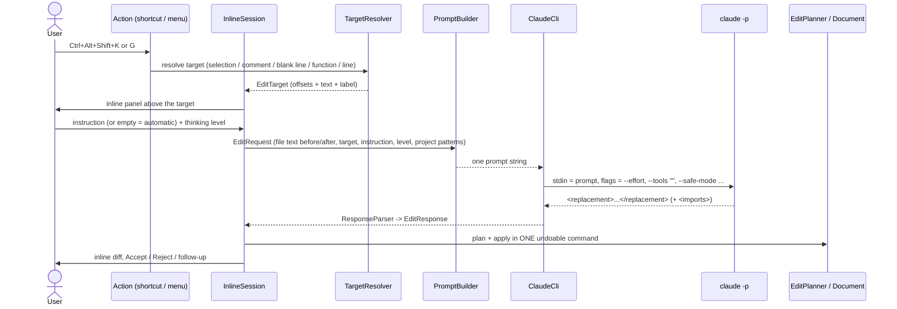

# Architecture

How Inline AI Prompt works, from the key press to the accepted edit.

## Overview

The plugin does not talk to an API itself. It shells out to your local Claude Code CLI (`claude -p`), so it uses your
existing login, model access and settings. Everything else (finding the target, building the prompt, applying and
reviewing the result) is plain IntelliJ Platform code.



## Components

| Piece | File | Responsibility |
| --- | --- | --- |
| Actions | `InlinePromptAction`, `ImplementFromContextAction`, `AnalyzeProjectAction` | Entry points. The first two start an `InlineSession`; the third runs the project analysis. |
| Session | `InlineSession` | One per editor. Owns the panel, the range marker on the target, the Claude rounds, accept and reject. |
| Panel | `InlineChatPanel` | Swing UI embedded between editor lines (`EditorEmbeddedComponentManager`): input, thinking level, Processing/Stop, Accept/Reject, banner. |
| Target | `TargetResolver` | Decides what Claude edits (see below). Uses the Python PSI (`PyFunction`, `PsiComment`). |
| Prompt | `PromptBuilder` | Builds the single stdin prompt, with region markers and a strict reply format. |
| Auto text | `AutoInstruction`, `SlashCommands` | The instruction used when the input is empty, and the `/doc`, `/fix` ... shortcuts. |
| CLI | `ClaudeCli` | Finds the executable, runs it, streams stdin/stdout, handles timeout and cancel (kills the process tree). |
| Reply | `ResponseParser` | Extracts `<replacement>` and `<imports>`, normalises line endings, never strips indentation. |
| Apply | `EditPlanner`, `EditPlan`, `EditReverter` | Computes the text edits (replacement plus new imports), applies them, and can restore the original. |
| Diff | `InlineDiffView`, `DiffPreviewDialog` | Inline highlighting of the change in the editor; a side-by-side dialog for "Show diff". |
| Settings | `ClaudeInlineSettings`, `ClaudeInlineConfigurable` | Persisted options and the Settings | Tools page. |
| Patterns | `ProjectAnalyzer`, `ProjectPatternsStore` | One-off codebase analysis and its saved profile. |

## What gets edited (target resolution)

First match wins:

1. A non-empty selection, exactly as selected (leading indentation of its first line is included).
2. A comment-only line. The whole block of consecutive comment lines becomes the target. If a function starts on the
   line right below, the comment and the function together are the target.
3. A blank line: new code is inserted there.
4. The innermost Python function containing the caret, decorators included.
5. The current line.

The target text and offsets are captured in an `EditTarget`. The session keeps a `RangeMarker` on it so the position
survives edits made elsewhere while Claude is working.

## The prompt

`PromptBuilder` produces one string that is written to the CLI's standard input:

1. An optional thinking keyword line (`think`, `think hard`, `think harder`, `ultrathink`).
2. Instructions: the reply must be only `<replacement>...</replacement>`, the markers around the region are layout, a
   kind-specific rule (function / selection / line / comment / insert), indentation rules, "change only what is asked",
   and for Python an optional `<imports>` block. `<error>reason</error>` is the escape hatch.
3. Optionally the project conventions profile (see below).
4. The file, with the region wrapped in `<<<REGION ... REGION>>>`. Each side is capped at 20,000 characters and cut on a
   line boundary, with an `[... N lines omitted ...]` marker.
5. The user's instruction, last.

An empty input uses `AutoInstruction.forKind(kind)`: implement a stub function from its name, signature and docstring,
or turn a comment into the code it describes, or write the code that belongs at a blank line.

## Running Claude

```
claude -p --output-format text --no-session-persistence
       --tools ""                (or Read,Grep,Glob when read-only tools are enabled)
       --safe-mode               (isolated mode: skip CLAUDE.md, hooks, MCP servers, skills)
       --effort medium|high|xhigh|max   (from the thinking level; none for Default)
       --model <m>               (only if set)
```

The prompt goes through stdin, so there are no quoting problems on Windows, including `.cmd` shims. Isolated mode matters
for speed: a measured tiny request took about 3.4 s with `--safe-mode` and about 11.4 s without it, because a large
personal CLAUDE.md and several MCP servers were otherwise loaded on every call.

The request runs in a cancellable background task. On Stop, timeout or editor close, the whole process tree is killed.

## Applying and reviewing

The result is applied to the document immediately, as one undoable command named "Inline AI Edit":

- `EditPlanner` builds the edits: the replacement for the region and, for Python, any missing imports inserted after the
  last top-level import (or after the module docstring).
- Before applying, the session checks that the region still equals the text that was sent. If you edited it meanwhile,
  the result is discarded with a banner.
- `InlineDiffView` compares the original text with the new region line by line. New lines are highlighted, removed lines
  appear above them as a block.

**Accept** just closes the panel; the text is already in place. **Reject** restores the original text and removes the
inserted imports in a second undoable command ("Inline AI Reject"), so Ctrl+Z brings Claude's result back.
A follow-up request in the same panel works on the current region, and the diff stays relative to the original text.

## Project patterns

`Tools | Inline AI: Analyze Project Patterns` runs Claude once over the project with read-only tools (Read, Grep, Glob)
and asks for a Markdown profile: stack and layout, API pattern, DB access, Redis usage, cache-aside (including the
existing helpers to reuse), conventions and a reuse checklist. It is saved to `.inline-ai/project-patterns.md`.
When "Use project patterns" is on, that file (capped at 12,000 characters) is added to every edit prompt with the rule
to follow it and reuse the helpers it names. The file is plain Markdown: edit it, commit it, refresh it by running the
action again.

## Design decisions

- **CLI instead of an API client.** Reuses the user's login and model access; no keys are stored by the plugin.
- **Apply first, review inline.** Mirrors GitHub Copilot's inline chat (inspected in PyCharm 2026.2): an embedded panel,
  Processing with Stop, an inline diff, Accept/Reject, errors as a banner, follow-ups, slash commands.
- **Strict reply format.** Tags instead of markdown fences make the reply easy to parse and keep indentation intact.
- **No tools by default.** Claude gets text in and text out, which is faster and cannot touch files.

## Tests

`./gradlew test` runs unit tests for the prompt, reply parser, edit planning, CLI handling and the profile store, and
platform tests (`BasePlatformTestCase` with the Python plugin) for target resolution and edit application. Two tests call
the real Claude CLI and only run when the environment variable `CLAUDE_CLI_IT=1` is set.

## Not covered by automated tests

The visual behaviour inside a running IDE: panel layout, the animated indicator, key handling inside the embedded panel,
and the colours of the inline diff. These need a manual check (`./gradlew runIde`).
